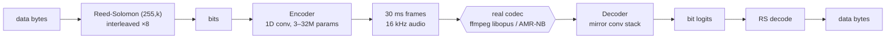

# voice-codec-modem

**Send digital data through a voice call.** A neural data-over-voice modem that hides bytes in speech-like audio and gets them back intact after the lossy speech codecs used by Zoom, Teams, Discord, WhatsApp and cellular voice (Opus and AMR-NB).

[](LICENSE)


**[Live demo](https://voice-channel-poc-production.up.railway.app)** · [Results](#results) · [Quickstart](#quickstart) · [How it works](#how-it-works) · [Limitations](#limitations) · [Prior art](#prior-art)

Voice channels are built to throw away anything that isn't speech. Classic acoustic modems (FSK, chirps) barely survive them. This project trains an encoder/decoder pair with the real codec in the training loop, so the network learns which signals the codec keeps. Plain bits, a second voice (Codec2) or signed metadata can ride on top.

It's a research artifact, not a product: a reproducible map of rate vs. how natural the audio sounds vs. which channel it survives, with working code, trained checkpoints and audio you can listen to.

---

## Results

All rates are post-FEC payload rates through **real** codecs (ffmpeg-libopus, ffmpeg-libopencore-amrnb), never a simulated channel.

| Carrier sounds like | Channel | Reliable rate | Status |
|---|---|---|---|
| Modem tone | Opus 24k VOIP (Zoom, Teams, WebRTC) | **3196 bps** | ✅ re-verified: 0 errors in 45,600 bits (3 seeds) |
| Speech-textured noise | Opus 24k VOIP | 2125 bps (0.05% residual BER), 1598 bps (0 errors) | reported |
| Speech-like babble | Opus 24k VOIP | 799 bps | reported |
| **Real human speech + audible hiss** | Opus 24k VOIP | **531 bps** | ✅ re-verified: 0 payload errors in 76,000 bits (5 runs); 1 of 80 RS blocks failed in padding, so this rate is near the edge |
| Real human speech + audible hiss | Opus 48k AUDIO (Discord, music mode) | 933 bps | reported |
| Real human speech + audible hiss | **AMR-NB 12.2k (2G/3G cellular, PSTN)** | **76 bps** | reported (needs ffmpeg with AMR-NB, see below) |
| Voiced synthetic tone, no neural net | Opus 24k VOIP | 175 bps | ✅ re-verified: 0 errors in 152,000 bits (10 seeds) |
| Pitch wobble on real speech | Any speech codec, including speaker → mic | ~5 bps | reported |

"Re-verified" means the numbers were rerun from a clean checkout on 2026-11-01. "Reported" means numbers from the original training runs that weren't rerun.

The cellular result is the unusual one. Most open-source audio watermarking targets MP3, AAC or Opus. We know of no other open-source method that works blind in the waveform domain through AMR-NB.

### Listen

Every variant ships with WAV files: cover → modified → after the codec.

| What | Files |
|---|---|
| Voice-within-voice, modem-tone carrier, Opus 24k | [`core/neural_codec/demo_outputs/`](core/neural_codec/demo_outputs/): `05_transmitted_carrier_audio_16k.wav` is what goes over the call, `07_recovered_voice_within_voice_16k.wav` is the hidden voice recovered |
| Real-speech cover, Opus 24k | [`core/neural_codec/stego/listen_samples/`](core/neural_codec/stego/listen_samples/) |
| Real-speech cover, AMR-NB cellular | [`core/neural_codec/cellular/listen_samples/`](core/neural_codec/cellular/listen_samples/) |
| Speech-textured carriers | [`adversarial/`](core/neural_codec/adversarial/), [`sequence/`](core/neural_codec/sequence/) |

### Try it over a real call

The [live demo](https://voice-channel-poc-production.up.railway.app) has two tabs:
- **Send:** encodes text and plays it.
- **Listen:** records from your microphone and decodes.

Open Send on one machine and Listen on another, with a Zoom, Meet or phone call between them. Nobody has yet measured how well the signal survives a live call with default noise suppression, echo cancellation and packet loss (see [Limitations](#limitations)). If you try it, please [open an issue](https://github.com/rozetyp/voice-codec-modem/issues) with the app, the settings and whether the message decoded.

---

## Quickstart

```bash
git clone https://github.com/rozetyp/voice-codec-modem.git
cd voice-codec-modem

python3.12 -m venv .venv
.venv/bin/pip install -r requirements.txt

brew install ffmpeg codec2            # macOS
# sudo apt-get install ffmpeg codec2  # Debian/Ubuntu (its ffmpeg includes AMR-NB)
```

**1. Measure the headline rate** (about 15 s on a laptop, CPU or Apple MPS):

```bash
.venv/bin/python core/neural_codec/neural_with_fec.py core/neural_codec/ckpt_n128_mixed.pt --seeds 3
# FEC: RS(255,191) depth=8 -> eff_bitrate=3196 bps
# TOTAL                                 0.0000% (0/45600 bits)
```

**2. Hide a voice inside a voice:** Codec2 at 2400 bps, sent through Opus 24k VOIP:

```bash
.venv/bin/python core/neural_codec/voice_within_voice_demo.py --length_s 10 --codec2_mode 2400
# raw bit BER: 0.925%  (FEC blocks: 16 ok, 0 failed)
# ✅ payload bytes EXACTLY recovered — decoded audio bit-identical to Codec2 reference
```

**3. Run the web demo locally:**

```bash
.venv/bin/uvicorn app.server:app --port 8080   # open http://localhost:8080
```

| Script | What it measures |
|---|---|
| `core/neural_codec/eval_real_opus.py <ckpt> --seeds 5` | Raw BER of any IID checkpoint through libopus |
| `core/neural_codec/stego/stego_listen.py --ckpt core/neural_codec/stego/ckpt_stego_p3.pt` | Real-speech cover: BER, SNR, listenable WAVs |
| `core/neural_codec/cellular/amrnb_eval_with_rep.py` | AMR-NB cellular variant with repetition coding |
| `core/neural_codec/adversarial/realism_eval.py` | How close each carrier sounds to real speech |
| `core/triz_pitch/v5_final_validate.py` | Hand-coded modem, needs `opuslib` (see `requirements.txt`) |
| `app/voice_within_voice.py` | Codec2 700C hidden in a real-speech cover at 531 bps |

**Notes**
- **AMR-NB:** Homebrew's ffmpeg is built without `libopencore-amrnb`, so the cellular scripts fail on macOS. Use Linux, or build the Docker image.
- **Speech clips:** scripts that need real speech read `tests/data/raw/*.wav` when it exists. Otherwise they use the bundled 30 s clip in `app/static/cover.wav`.
- **`pyworld`:** only the prosody modem and `experiments/test_stacked_channel.py` need it.

---

## How it works



**Codec in the training loop.** Most training steps go through a differentiable stand-in for the codec (lowpass plus shaped noise). Every 25 iterations, a straight-through step runs the real ffmpeg libopus encoder on the forward pass and passes the gradient through unchanged. That closes the gap between the stand-in and the real codec, which training on the stand-in alone never does ([Juvela 2024](https://arxiv.org/abs/2409.13382)). AMR-NB's ACELP coding is too far from any simple stand-in, so the cellular model runs real ffmpeg-amrnb on every step. That's 5–10× slower, but it's the only setup that converged.

**Steganographic variants** take `(cover_speech, bits)` and output a small additive perturbation, scaled by the cover's loudness so louder speech hides more. The cover is real speech, which the codec is designed to keep, so the bits ride underneath it.

**Hand-coded modem** ([`core/triz_pitch/`](core/triz_pitch/)) uses no neural network. It synthesizes voiced audio in which pitch, gain and spectral tilt carry the data, because Opus faithfully preserves those three features. It stacks three channels and adds bit-interleaved Reed-Solomon over GF(256), and needs no GPU.

### Checkpoints

| Checkpoint | Rate | Carrier | Use it for |
|---|---|---|---|
| `core/neural_codec/ckpt_n128_mixed.pt` | 3196 bps | Modem tone | Machine-to-machine over a call |
| `core/neural_codec/adversarial/ckpt_n128_adv.pt` | 2125 bps | Speech-textured noise | Balance of rate and realism |
| `core/neural_codec/adversarial/ckpt_n64_adv.pt` | 1598 bps | Speech-textured noise | Lower rate, zero residual errors |
| `core/neural_codec/sequence/ckpt_seq_adv.pt` † | 799 bps | Speech-like babble | Closest to real speech (mel-L1) |
| `core/neural_codec/stego/ckpt_stego_p3.pt` | 531 bps (24k VOIP), 933 bps (48k AUDIO) | Real speech + hiss | Hidden in a normal-sounding call |
| `core/neural_codec/cellular/ckpt_amrnb_real.pt` | 76 bps | Real speech + hiss | 2G/3G cellular voice |

† Not in git (too large). The other checkpoints, 9–21 MB each, are committed.

---

## Repository layout

```
core/neural_codec/      trained codecs, eval and demo scripts (neural_codec.py holds the shared model)
  adversarial/          IID + adversarial realism loss
  sequence/             cross-symbol (sequence) codec
  stego/                real-speech cover steganography
  cellular/             AMR-NB variant
  prosody/              pitch-modulation modem (~5 bps, any codec)
  composite_attempt/    documented negative result: band-split carrier
core/triz_pitch/        hand-coded pitch/gain/tilt modem (no neural net)
app/                    FastAPI web demo (server.py, pipelines.py, static/)
experiments/            Modal GPU training jobs and probes (EnCodec, Mimi, DAC, two-talker, prosody)
Dockerfile, railway.json  deploy config for the web demo
```

Scripts are run by path, not installed as a package. Each one puts `core/neural_codec/` and its subfolders on `sys.path`. `app/pipelines.py` keeps its own copy of the model classes, so the Docker image doesn't need the training code.

---

## Limitations

- **Live calls are untested.** Every result is file-based: encode, pass through ffmpeg, decode. There's no jitter, packet loss or sync preamble yet, and no full-duplex use. Zoom's and Teams' default AI noise suppression is the biggest open risk, because it's designed to remove sound that isn't speech.
- **The carrier is audible.** The best real-speech variant reaches about 13–15 dB SNR, which you hear as hiss. True watermark-grade imperceptibility (>25 dB) wasn't reached.
- **Other codecs are uncharacterized:** AMR-WB, EVS, G.711 and G.722.
- **No adversarial robustness.** The models were never trained against a steganalysis detector.
- **Cellular was tested through ffmpeg only,** not over a real network.
- **76 bps is far below codec-internal AMR steganography,** which reaches 1–3 kbps (Tian et al. 2018). Those methods modify the AMR encoder itself. This one is blind: the sender produces an ordinary WAV and the network's codec is untouched. They solve different problems; this is not "better".
- **The methods aren't new.** Codec-in-the-loop training and watermark-style steganography are published. The contribution is the measured map across three classes of voice codec, plus reproducible code and audio.

Earlier prototypes (an FSK/band-energy "2.7 kbps" modem and others) didn't reproduce their claimed rates and were removed. They remain in the [`v0.1.0`](https://github.com/rozetyp/voice-codec-modem/tree/v0.1.0) tag for the record.

---

## Prior art

| Project | Rate | Notes |
|---|---|---|
| [Juvela 2024, codec-augmented watermarking](https://arxiv.org/abs/2409.13382) | — | The straight-through codec-in-loop training used here |
| [AudioSeal](https://github.com/facebookresearch/audioseal) (Meta) | 16 bps | The leading open-source watermark; far more imperceptible, much lower capacity |
| [SilentCipher](https://github.com/sony/silentcipher) (Sony) | ~30 bps | Near-imperceptible |
| [WavMark](https://github.com/wavmark/wavmark) | 32 bps | |
| [ggwave](https://github.com/ggerganov/ggwave) | 8–16 bps | Over-the-air data with audible chirps |
| [Tian et al. 2018](https://link.springer.com/article/10.1007/s11042-017-4860-1) | 1–3 kbps | AMR codec-internal steganography (modifies the encoder) |

## Citation

```bibtex
@software{voice_codec_modem_2026,
  author = {rozetyp},
  title  = {voice-codec-modem: neural data-over-voice through Opus and AMR-NB},
  year   = {2026},
  url    = {https://github.com/rozetyp/voice-codec-modem}
}
```

## License

[Apache 2.0](LICENSE). Its explicit patent grant matters here, because audio watermarking has active patents (Verance/Cinavia, Audible Magic, NexGuard).

Training data:
- LibriSpeech dev-clean (CC BY 4.0) for the diversity-trained checkpoints.
- Early stego checkpoints were trained on two short clips, a TTS read-aloud and a podcast excerpt. Neither clip is distributed.

`app/static/cover.wav` is [ElevenLabs](https://elevenlabs.io) text-to-speech. Audio passes through real ffmpeg libopus and libopencore-amrnb throughout.
